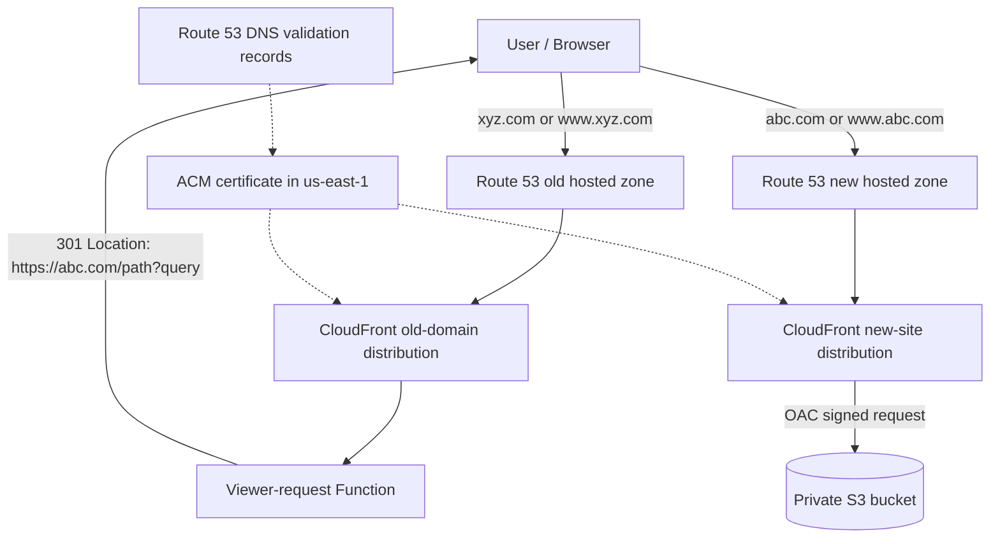

# AWS Domain Migration (xyz.com → abc.com)

A portfolio-ready, Terraform-driven reference implementation for migrating a domain while keeping the old hostname available as a permanent redirect.

> **Important:** `xyz.com` and `abc.com` are example domains. Replace them with domains you own or are authorized to manage. This project creates billable AWS resources. Review `terraform plan` and estimated costs before applying.

## What this builds

- A private S3 bucket for the new site's static content.
- CloudFront Origin Access Control (OAC); the S3 bucket is not public.
- A CloudFront distribution for `abc.com` and `www.abc.com`.
- A CloudFront Function on the old-domain distribution that returns HTTP 301 to `https://abc.com`, preserving the request path and query string.
- A second CloudFront distribution for `xyz.com` and `www.xyz.com`.
- One ACM certificate in **us-east-1** covering all four hostnames, with Route 53 DNS validation.
- Route 53 alias records for the apex and `www` hostnames.
- HTTPS-only origin access, HTTP-to-HTTPS viewer behavior on the new site, versioning, encryption, public-access blocks, and deployment/validation/rollback scripts.

## Architecture



## Repository layout

```text
project-5-aws-domain-migration/
├── README.md
├── ARCHITECTURE.md
├── terraform/
│   ├── versions.tf
│   ├── providers.tf
│   ├── variables.tf
│   ├── main.tf
│   ├── acm.tf
│   ├── s3.tf
│   ├── cloudfront.tf
│   ├── route53.tf
│   ├── outputs.tf
│   ├── terraform.tfvars.example
│   └── functions/old-domain-redirect.js
├── site/index.html
├── scripts/
│   ├── deploy.ps1
│   ├── validate.ps1
│   ├── invalidate.ps1
│   └── rollback.ps1
├── tests/
│   ├── redirect-function.test.js
│   └── run-tests.ps1
├── .gitignore
└── .github/workflows/terraform-validate.yml
```

## Prerequisites (Windows)

Install and verify:

- AWS CLI v2
- Terraform (version constraint is in `terraform/versions.tf`)
- Git
- Node.js 18+ (for the local CloudFront Function unit test)

Configure credentials using an IAM Identity Center profile or another approved credential method. Avoid long-lived access keys where possible.

```powershell
aws --version
terraform -version
git --version
node --version
aws sts get-caller-identity --profile YOUR_PROFILE
```

The deployment identity needs permissions for Terraform-managed ACM, Route 53, S3, CloudFront, IAM policy, and related read operations. Use least privilege and a dedicated deployment role in a real environment.

## Configure

1. Confirm you control both domain names and that the public hosted zones already exist in Route 53.
2. Copy the example variables file.
3. Replace every example value with your own values.

```powershell
Set-Location .\terraform
Copy-Item terraform.tfvars.example terraform.tfvars
notepad terraform.tfvars
```

Example `terraform.tfvars`:

```hcl
aws_region          = "ap-south-1"
aws_profile         = "YOUR_PROFILE"
project_name        = "domain-migration"
old_domain          = "xyz.com"
old_www_domain      = "www.xyz.com"
new_domain          = "abc.com"
new_www_domain      = "www.abc.com"
old_hosted_zone_id  = "Z0123456789OLDZONE"
new_hosted_zone_id  = "Z0123456789NEWZONE"
```

`old_hosted_zone_id` and `new_hosted_zone_id` are the **existing public hosted zone IDs**. Do not include the `/hostedzone/` prefix. If both domains are in the same hosted zone, use the same ID for both variables. Do not create duplicate hosted zones.

## Deploy

From the `terraform` directory:

```powershell
terraform init
terraform fmt -recursive
terraform validate
terraform plan -out=tfplan
terraform show tfplan
# Only after reviewing the plan:
terraform apply tfplan
```

Terraform requests the ACM certificate and creates DNS validation records. ACM validation and CloudFront distribution deployment can take several minutes. CloudFront changes may take longer to reach all edge locations.

Upload the site after the distribution is created:

```powershell
Set-Location ..
.\scripts\deploy.ps1 -Profile YOUR_PROFILE -Region ap-south-1
```

The script reads the bucket and distribution IDs from Terraform outputs. It uploads with cache metadata and creates a CloudFront invalidation.

## Validate

```powershell
.\scripts\validate.ps1 -OldDomain xyz.com -NewDomain abc.com -Profile YOUR_PROFILE
```

Expected results:

- `https://xyz.com/products/item?campaign=spring` returns `301`.
- The `Location` header is `https://abc.com/products/item?campaign=spring`.
- `https://abc.com/` returns `200`.
- HTTP requests to the new site are redirected to HTTPS.
- The S3 website endpoint is not used; direct public S3 object access should be denied.

You can also inspect DNS and TLS:

```powershell
Resolve-DnsName xyz.com
Resolve-DnsName abc.com
curl.exe -I "https://xyz.com/path?x=1"
curl.exe -I "https://abc.com/"
```

## Caching and redirect behavior

- The CloudFront Function builds the redirect URL from the configured destination plus the incoming URI and query string.
- Redirect responses include a short `Cache-Control` lifetime to reduce stale browser/CDN behavior during the migration window. A browser may still retain a 301; test with a fresh browser profile or `curl.exe`.
- The new site's cache policy uses a bounded TTL. The sample HTML is uploaded with `Cache-Control: public,max-age=300`.
- After changing site content, the deployment script creates an invalidation for `/*`. Prefer versioned asset filenames and targeted invalidations for larger sites.
- Query strings are preserved in the redirect but are not forwarded to the S3 origin by default because this is a static site.

## Cutover plan

1. Inventory existing DNS records, TTLs, certificates, redirects, analytics, email records, and third-party integrations.
2. Lower relevant DNS TTLs ahead of the planned cutover (for example, 300 seconds), allowing the previous TTL to expire.
3. Provision and validate the new certificate and both CloudFront distributions before switching traffic.
4. Upload and test the new site using the CloudFront hostname or a controlled hosts-file/test environment.
5. Verify the old-domain 301 redirect, path preservation, query preservation, and no redirect loop.
6. Update Route 53 alias records and monitor DNS, CloudFront, origin errors, and application analytics.
7. Keep the old domain, certificate, DNS, and redirect distribution active for the agreed migration/SEO retention period.

## Rollback strategy

A domain migration is not rolled back by simply deleting the new distribution. Preserve the old service until the new site is proven stable.

- If the new site is unhealthy, change the old-domain CloudFront Function destination back to the previous working hostname or disable the redirect function after testing the intended recovery.
- If DNS was changed to the new distribution prematurely, restore the prior Route 53 record values from the captured change record/backup.
- If a browser has cached a 301, server-side rollback may not immediately change that browser's behavior. Use a controlled temporary redirect response with short cache headers during the rollback window; communicate that client caches can persist.
- Do not destroy production resources during incident recovery. Use `terraform plan` to inspect the exact changes before applying.

A starter helper is provided at `scripts/rollback.ps1`; it intentionally does **not** make blind DNS changes. It prints the required controlled recovery steps.

## Security and production considerations

- Keep S3 Block Public Access enabled and use CloudFront OAC.
- Keep bucket encryption and versioning enabled.
- Store Terraform state remotely with encryption, versioning, and locking in a separately managed backend. This example intentionally leaves backend configuration to the operator so bootstrap dependencies are not hidden.
- Do not commit `terraform.tfvars`, state files, plan files, credentials, or private keys.
- Use IAM roles/Identity Center, MFA, least privilege, and approval controls for production applies.
- Consider WAF, access logging, CloudFront standard logging, alarms, synthetic checks, and multi-account separation for a production deployment.
- Protect existing MX, TXT, SPF, DKIM, DMARC, CAA, and verification records. This project only manages the four web alias records and ACM validation records.
- Certificate DNS validation records must remain in DNS for automatic renewal.

## Troubleshooting runbook

| Symptom | Likely cause | Investigation / action |
|---|---|---|
| ACM stuck at Pending validation | Wrong hosted zone, missing CNAME, DNS delegation issue | Inspect `terraform output certificate_arn`; verify ACM validation CNAMEs in the authoritative public zone |
| CloudFront 403 | OAC bucket policy mismatch, missing object, default root object mismatch | Check bucket policy, CloudFront origin, object key and `index.html`; inspect CloudFront response headers |
| CloudFront 502/503 | Origin or distribution configuration issue | Confirm S3 regional REST endpoint and distribution deployment status |
| Certificate mismatch | Certificate not in us-east-1 or SAN missing | Verify ACM region and all four SANs |
| Redirect loop | Old and new domains point to the old redirect distribution or destination is wrong | Ensure new domain aliases point to the content distribution and redirect destination is `https://abc.com` |
| Path/query missing | Function URL construction bug | Run Node unit tests and inspect `Location` with `curl.exe -I` |
| Old redirect persists after change | Browser cached 301 | Test with curl/new profile; keep redirect cache TTL short during cutover |
| Content appears stale | CloudFront edge cache | Inspect `Age`/`Cache-Control`; invalidate the changed paths |
| DNS resolves to old target | Resolver cache / old TTL / incorrect alias | Check authoritative nameservers and multiple resolvers; wait for TTL |

## Interview-ready scenarios

**1. Why must the CloudFront ACM certificate be in us-east-1?**  
CloudFront requires its viewer certificate to be requested or imported in US East (N. Virginia), `us-east-1`, even when the S3 bucket and Terraform provider's primary region are elsewhere.

**2. Why use S3 OAC instead of a public bucket?**  
OAC lets CloudFront sign origin requests. The bucket remains private and its bucket policy grants read access only to the intended distribution.

**3. How do you preserve path and query strings on a 301?**  
The viewer-request function appends `request.uri` and serializes `request.querystring` to the new HTTPS hostname. Unit tests cover nested paths, single/multiple query parameters, and root requests.

**4. How do TTL and invalidation differ?**  
TTL controls how long cached objects remain fresh. Invalidation explicitly removes selected cached paths before their TTL expires. Prefer versioned assets and targeted invalidations.

**5. How do you avoid downtime?**  
Provision and test the new stack before DNS cutover, lower TTL in advance, preserve old infrastructure, monitor after the change, and keep a documented rollback path.

**6. What causes redirect loops?**  
A destination hostname that resolves back to the redirect distribution, conflicting redirect rules, or an incorrect canonical-host mapping. Verify DNS targets and the `Location` header at each hop.

**7. Why can a 301 appear to ignore rollback?**  
Browsers and intermediaries may cache permanent redirects. Use `curl.exe` and a fresh profile to distinguish server behavior from client cache.

## Cleanup

Only after the migration retention period and after confirming no dependencies remain:

```powershell
Set-Location .\terraform
terraform plan -destroy
# Review carefully; then:
terraform destroy
```

This removes Terraform-managed infrastructure. It does not remove the external domain registration or hosted zones. Confirm S3 object deletion behavior and backups before destroying anything important.

## References

- [CloudFront alternate domain names and certificates](https://docs.aws.amazon.com/AmazonCloudFront/latest/DeveloperGuide/CNAMEs.html)
- [Restrict access to an S3 origin](https://docs.aws.amazon.com/AmazonCloudFront/latest/DeveloperGuide/private-content-restricting-access-to-s3.html)
- [CloudFront cache behavior](https://docs.aws.amazon.com/AmazonCloudFront/latest/DeveloperGuide/Expiration.html)
- [CloudFront Functions](https://docs.aws.amazon.com/AmazonCloudFront/latest/DeveloperGuide/cloudfront-functions.html)
- [ACM DNS validation](https://docs.aws.amazon.com/acm/latest/userguide/dns-validation.html)
- [Route 53 alias records](https://docs.aws.amazon.com/Route53/latest/DeveloperGuide/routing-to-cloudfront-distribution.html)
